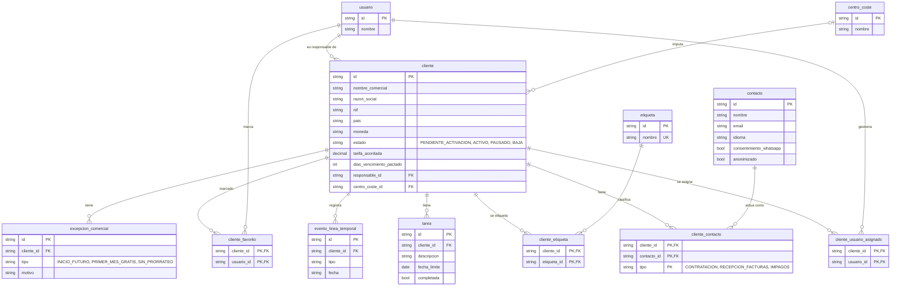
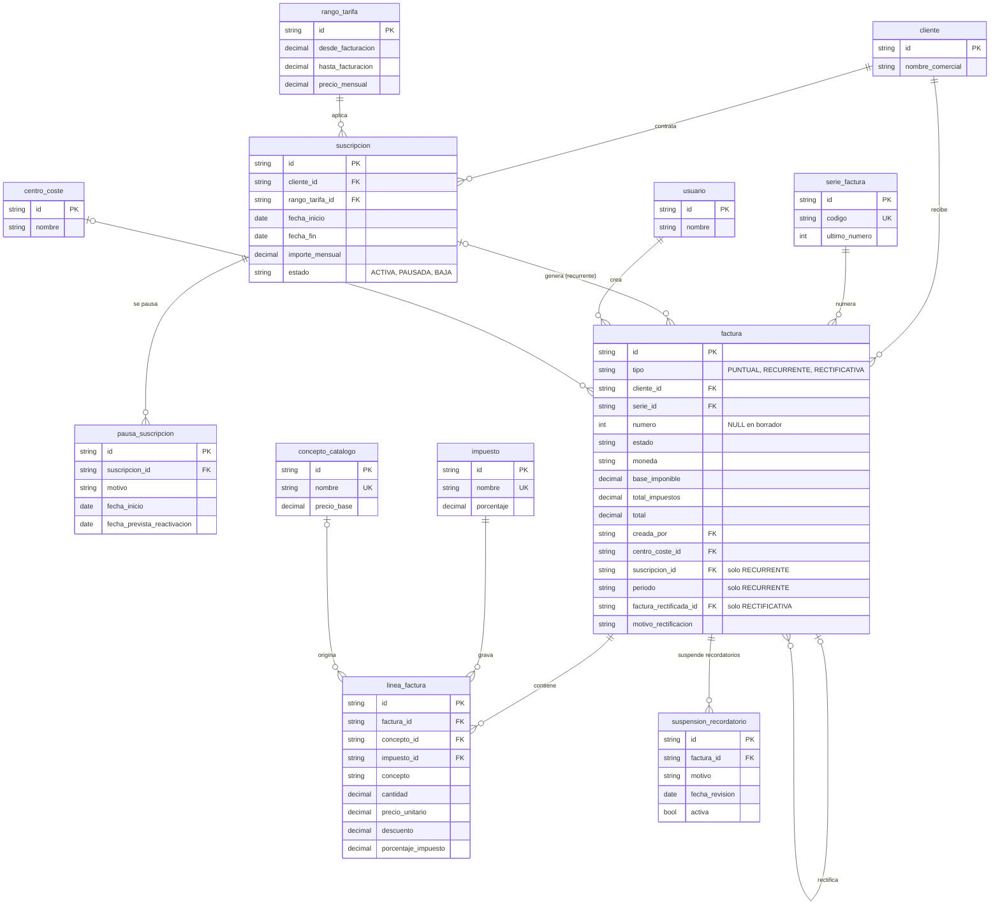
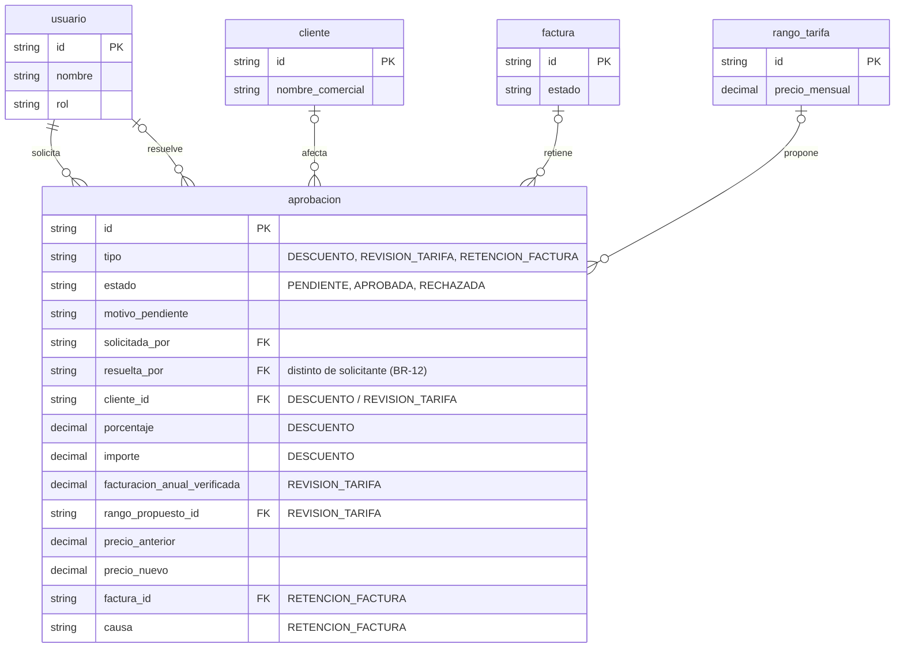
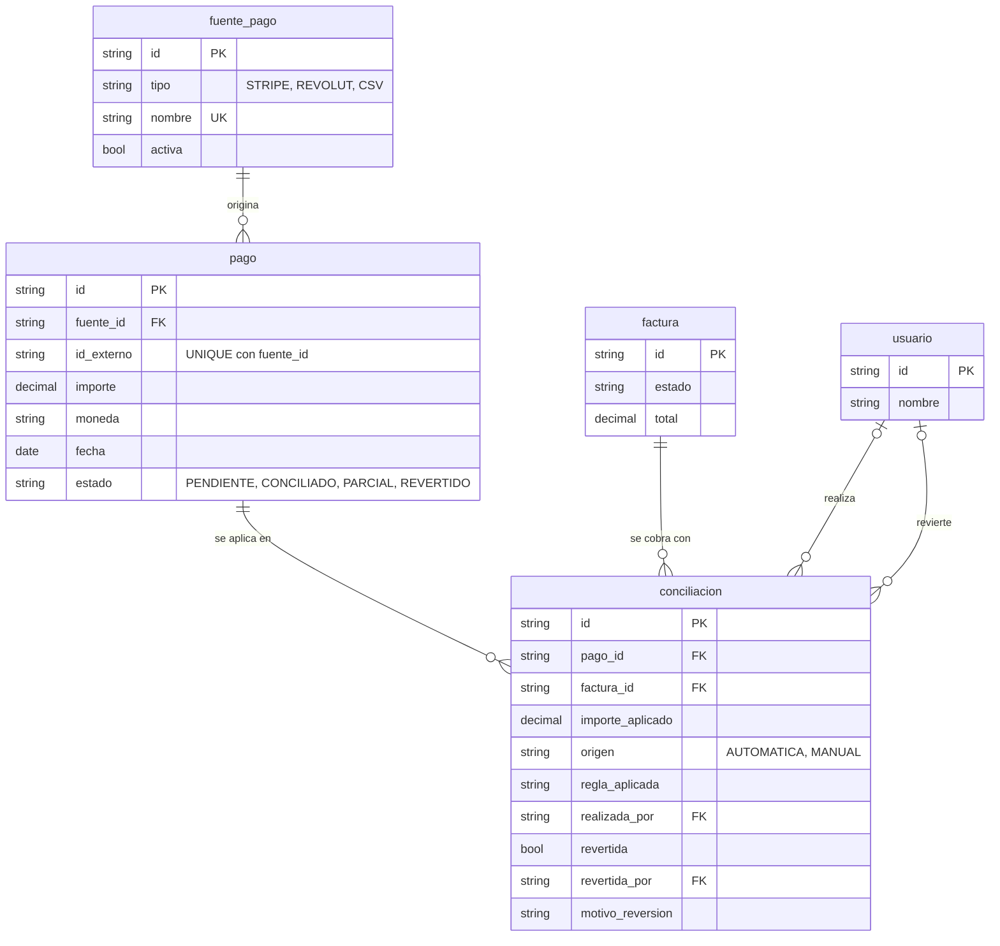
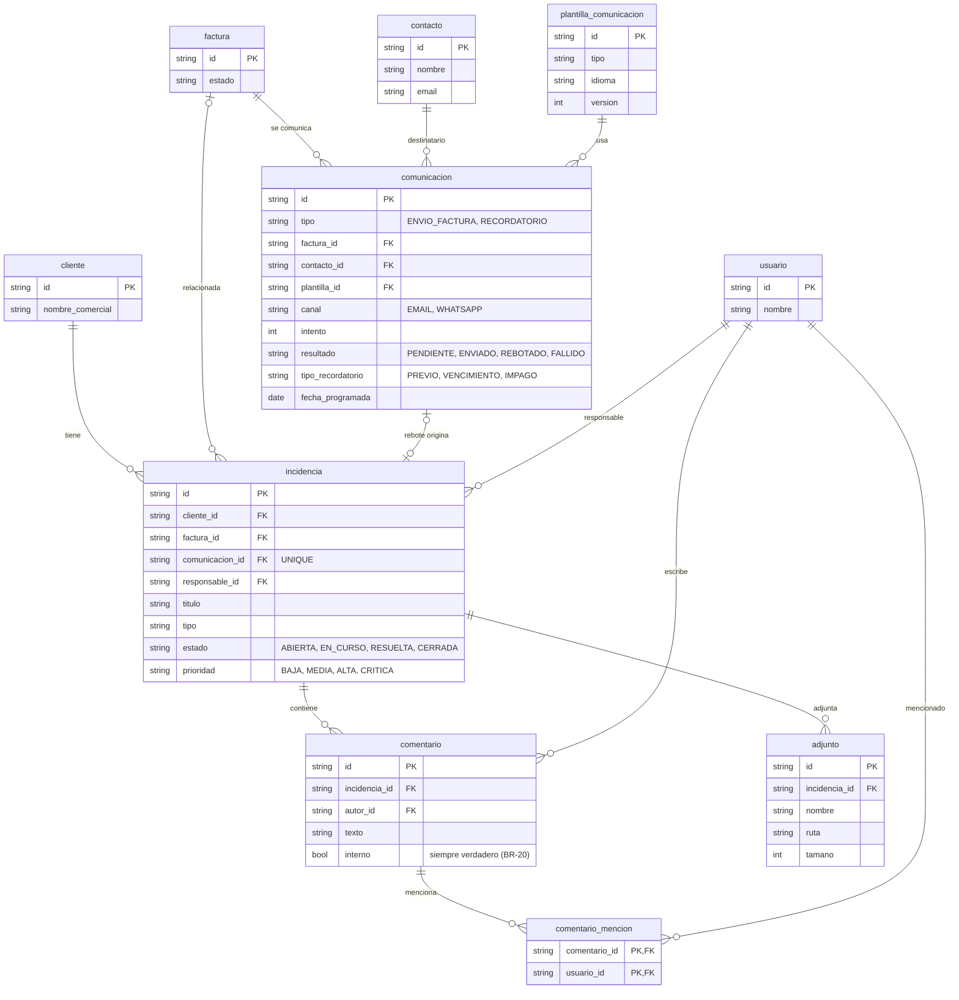
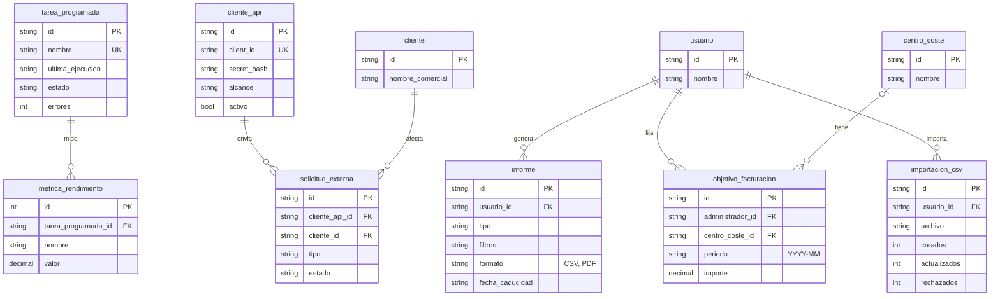

# JIRAFAS - Diagramas entidad-relación justificados

Este documento acompaña al esquema `jirafas.sql` (SQLite) y explica **por qué** está modelado así. Cada decisión se apoya en la documentación de la carpeta `doc/src`: `requisitos.md` (BR, UR, FR, NFR, RB, suposiciones A-xx y dudas Q-xx) y `ESPECIFICACION_CASOS_USO.md` (CU-01 a CU-37).

Sigue el plan de la Entrega 2 (entidades, atributos, claves primarias, claves foráneas, relaciones y cardinalidades): cada diagrama va seguido de la justificación de sus **entidades**, de sus **relaciones y cardinalidades** y de las **reglas** que el propio esquema hace cumplir.

Los diagramas muestran las claves y los campos más relevantes; el detalle completo de columnas está en `jirafas.sql`. Los diagramas se ven renderizados en GitHub, GitLab, VS Code (extensión Mermaid) o en mermaid.live.

**Notación de referencias:** BR = requisito de negocio, UR = requisito de usuario, FR = requisito funcional, NFR = no funcional, RB = regla de negocio, CU = caso de uso, A = suposición, Q = duda.

## 0. Criterios generales de modelado

Estas decisiones se repiten en todo el esquema, así que se explican una sola vez aquí.

| # | Decisión | Por qué se ha hecho así | Origen |
|---|---|---|---|
| 1 | **Jerarquías en una sola tabla con columna discriminadora** (`usuario.rol`, `factura.tipo`, `aprobacion.tipo`, `comunicacion.tipo`) | El sistema consulta siempre «todas las facturas» juntas: buscador, estados, informes. Además la numeración correlativa es **por serie, no por tipo**, de modo que facturas puntuales, recurrentes y rectificativas deben compartir tabla para que un único `UNIQUE (serie_id, numero)` cubra las tres. El coste son columnas NULL en los subtipos que no las usan, que se compensa con `CHECK` que obligan a que cada subtipo traiga sus campos y los demás no. | FR-01, FR-19, FR-25, FR-28, BR-10 |
| 2 | **Enumeraciones como `TEXT` + `CHECK`** | SQLite no tiene `ENUM`. Los valores cerrados salen del propio documento: estados de factura, tipos de contacto, tipos de excepción, canales, etc. | FR-04, FR-19, FR-46, FR-47 |
| 3 | **Importes con `NUMERIC(14,2)`** (precio unitario con 4 decimales, cantidad con 3) | Los importes se gestionan con precisión decimal y sin `float`. Ver el punto 4 de la sección «Puntos a revisar», porque SQLite exige cuidado adicional. | NFR-06 |
| 4 | **Copias históricas (snapshots)** en lugar de referencias vivas: `linea_factura.concepto` y `porcentaje_impuesto`, `suscripcion.importe_mensual`, `aprobacion.precio_anterior/precio_nuevo`, `factura.moneda` | Cambiar una tarifa, un concepto, un impuesto o una plantilla **no debe reescribir facturas ya emitidas**. Por eso la línea guarda su propio texto y su propio porcentaje, y la factura conserva su moneda original. | BR-11, FR-17, RB-02, FR-10 |
| 5 | **Nada importante se borra: se desactiva, se revierte o se rectifica** (`activo`, `revertida`, `anonimizado`, `factura_rectificada_id`) | Una factura emitida no se modifica ni se borra, solo se rectifica. Una conciliación errónea se revierte dejando constancia. Un usuario o contacto se desactiva conservando su rastro. | BR-09, FR-22, FR-07, FR-04, BR-19, NFR-18 |
| 6 | **Política `ON DELETE` según el tipo de dato** | `CASCADE` solo para datos auxiliares que no tienen vida propia (tareas, etiquetas, tokens, filtros, líneas de un borrador). `RESTRICT` o ausencia de cascada para todo lo que tiene valor legal o de auditoría (facturas, conciliaciones, comunicaciones, auditoría, contactos asociados). Así no se puede perder un documento fiscal arrastrándolo con un borrado de otra tabla. | BR-09, BR-19, NFR-09 |
| 7 | **Identificadores**: `TEXT` aleatorio de 16 bytes en hexadecimal; `INTEGER AUTOINCREMENT` solo en `registro_auditoria` y `metrica_rendimiento` | SQLite no tiene UUID. Los identificadores no secuenciales no son adivinables, lo que encaja con que los documentos no sean accesibles por URLs adivinables. En los dos registros de solo-añadir interesa un orden temporal estricto y no se exponen al usuario. | NFR-17, NFR-09 |
| 8 | **Reglas de negocio críticas también en la base de datos** (`UNIQUE`, índices únicos parciales y `CHECK`) y no solo en la aplicación | Las acciones simultáneas o los reintentos tras un fallo no pueden crear duplicados aunque la aplicación se equivoque: la base de datos los rechaza. Se aplica a la numeración, a la factura recurrente por periodo, al evento de pago duplicado y a la regla de que quien aprueba no puede ser quien solicita. | BR-10, NFR-13, NFR-15, FR-15, BR-12 |
| 9 | **`configuracion_sistema` como tabla de una sola fila** (`CHECK (id = 1)`) | La configuración es global y la edita solo el Superadministrador. Una única fila evita que existan dos configuraciones contradictorias. | FR-05, FR-18, CU-35, CU-36 |

## 1. Configuración, catálogos, usuarios y seguridad

```mermaid
erDiagram
    configuracion_sistema {
        int id PK "singleton (id = 1)"
        int dias_recordatorio_previo
        int dias_vencimiento_general
        int frecuencia_impago_dias
        decimal umbral_descuento
        decimal umbral_importe_alto
        string dominio_corporativo
    }
    serie_factura {
        string id PK
        string codigo UK
        string prefijo
        int ultimo_numero
    }
    impuesto {
        string id PK
        string nombre UK
        decimal porcentaje
    }
    rango_tarifa {
        string id PK
        decimal desde_facturacion
        decimal hasta_facturacion
        decimal precio_mensual
    }
    concepto_catalogo {
        string id PK
        string nombre UK
        decimal precio_base
    }
    plantilla_comunicacion {
        string id PK
        string tipo
        string idioma
        int version
    }
    centro_coste {
        string id PK
        string nombre UK
    }
    usuario {
        string id PK
        string nombre
        string email UK
        string rol "OPERATIVO, ADMINISTRADOR, SUPERADMINISTRADOR"
        bool puede_invitar_usuarios
        bool doble_factor_activo
    }
    token_recuperacion {
        string id PK
        string usuario_id FK
        string hash UK
        string expiracion
        bool usado
    }
    filtro_guardado {
        string id PK
        string usuario_id FK
        string nombre
        string criterios
    }
    preferencia_notificacion {
        string id PK
        string usuario_id FK
        string tipo_evento
        bool en_app
        bool por_email
        bool resumen_diario
    }
    notificacion {
        string id PK
        string usuario_id FK
        string tipo
        bool leida
        bool requiere_accion
        bool resuelta
    }
    regla_alerta {
        string id PK
        string administrador_id FK
        string tipo
        decimal parametro
    }
    registro_auditoria {
        int id PK
        string usuario_id FK "NULL = sistema"
        string accion
        string entidad
        string id_entidad
    }

    usuario ||--o{ token_recuperacion : "recupera"
    usuario ||--o{ filtro_guardado : "guarda"
    usuario ||--o{ preferencia_notificacion : "configura"
    usuario ||--o{ notificacion : "recibe"
    usuario ||--o{ regla_alerta : "define"
    usuario |o--o{ registro_auditoria : "genera"
```

### Justificación del diagrama 1

**Entidades**

| Entidad | Por qué existe y por qué tiene estos campos |
|---|---|
| `configuracion_sistema` | Reúne los parámetros que el Superadministrador configura: `dias_recordatorio_previo` y `dias_vencimiento_general` y `frecuencia_impago_dias` (cadencia de recordatorios, FR-05), `umbral_descuento` (a partir de él aprueba el Superadministrador, FR-18), `umbral_importe_alto` (qué es una factura puntual «de importe muy alto» que se retiene, FR-13), `dominio_corporativo` (login solo con dominio autorizado, FR-06 y A-01), `datos_emisor` y `retencion_informes_dias` (los informes se conservan un tiempo configurable, FR-37). |
| `serie_factura` | El Superadministrador configura las series (FR-01, UR-13). `ultimo_numero` es el contador de la numeración correlativa y única dentro de la serie (BR-10). `activa` permite retirar una serie sin borrarla, porque las facturas históricas la referencian. |
| `impuesto` | Los impuestos de una factura «podrán configurarse o seleccionarse entre los dados de alta» (FR-01). Es un catálogo con `activo` para poder retirar un impuesto sin afectar a facturas antiguas. |
| `rango_tarifa` | Tabla de tarifas por tramo de facturación anual (FR-10). Tiene `vigente_desde` y `vigente_hasta` porque el Superadministrador puede cambiar la tabla «para futuras revisiones sin reescribir las facturas históricas» (FR-17, BR-11): un cambio crea un rango nuevo y no sobrescribe el anterior. |
| `concepto_catalogo` | Catálogo de conceptos con precio base (BR-11). Las líneas de factura lo referencian de forma opcional, porque el concepto y el precio se pueden ajustar en cada línea (FR-02). |
| `plantilla_comunicacion` | Plantillas editables de factura, recordatorio previo, vencimiento, impago y disputa resuelta (FR-26; los cinco valores de `tipo` son exactamente esos). Tienen `idioma` (comunicación por cliente o contacto) y `version`, con `UNIQUE (tipo, idioma, version)`, para que editar una plantilla no altere el historial de qué plantilla se usó en cada envío (FR-26, BR-11). |
| `centro_coste` | Categorías administrables para clasificar clientes y facturas en informes, sin llegar a ser contabilidad (FR-40). Se usa `activo` y no borrado, porque renombrar o retirar una categoría no debe alterar el histórico. |
| `usuario` | Una sola tabla para los tres roles (UR-01, FR-07). La jerarquía Usuario Operativo, Administrador y Superadministrador se resuelve con `rol`, que además es un permiso acumulativo. `puede_invitar_usuarios` modela que un Administrador solo invita «si tiene permiso» (FR-07, UR-06) y su `CHECK` impide darlo a otros roles, porque el Superadministrador siempre puede. `activo` permite desactivar «sin borrar el rastro de sus acciones» (FR-07). `password_hash` evita guardar contraseñas en claro (NFR-17). `doble_factor_activo` cubre el doble factor opcional (NFR-09). |
| `token_recuperacion` | Enlace temporal de recuperación de contraseña (FR-06, UR-11). Se guarda el **hash** del token y no el token (NFR-17), con `expiracion` (se supuso 1 hora, A-03) y `usado` para que sea de un solo uso. |
| `filtro_guardado` | «Se podrán guardar filtros» (FR-28). Son personales de cada usuario; `UNIQUE (usuario_id, nombre)` evita nombres repetidos. |
| `preferencia_notificacion` | Cada usuario elige qué notificaciones ve en la aplicación, cuáles recibe por email y cuáles en resumen diario (FR-24, FR-42). Por eso tiene tres booleanos por `tipo_evento`. |
| `notificacion` | Bandeja de cada usuario, con `leida` y, para las que requieren acción, `resuelta` (FR-24). El `CHECK (NOT resuelta OR requiere_accion)` impide «resolver» una notificación que no pedía acción. |
| `regla_alerta` | Alertas del administrador como «conjunto cerrado de reglas parametrizables» (FR-42). Por eso `tipo` solo admite `DIAS_VENCIDA` e `IMPORTE_PENDIENTE_CLIENTE` con un `parametro` numérico, y no hay un motor genérico de reglas ni BPMN, que el requisito excluye expresamente. |
| `registro_auditoria` | Registro de «quién hizo qué y cuándo» consultable por el Superadministrador (NFR-09, CU-34). Guarda `valor_anterior` y `valor_nuevo` (CU-34 paso 6; también FR-10 y FR-41). Es solo de añadir (ver «Puntos a revisar»). |

**Relaciones y cardinalidades**

| Relación | Cardinalidad | Por qué |
|---|---|---|
| `usuario` → `token_recuperacion` | 1 a N | Un usuario puede pedir varios enlaces a lo largo del tiempo; cada uno caduca y es de un solo uso. Si se borra el usuario, sus tokens no tienen sentido (`CASCADE`). |
| `usuario` → `filtro_guardado`, `preferencia_notificacion`, `notificacion` | 1 a N | Son datos propios de cada usuario (FR-24, FR-28). `CASCADE` porque no tienen valor fuera de su dueño. |
| `usuario` → `regla_alerta` | 1 a N | Las define un administrador (FR-42). Sin `CASCADE`, para no perder reglas por un borrado. |
| `usuario` → `registro_auditoria` | 0..1 a N | `usuario_id` es opcional porque hay acciones del **sistema** (por ejemplo, el planificador) sin usuario. `ON DELETE RESTRICT` impide borrar un usuario con rastro, y por eso FR-07 pide desactivar y no borrar. |
| Catálogos (`serie_factura`, `impuesto`, `rango_tarifa`, `concepto_catalogo`, `plantilla_comunicacion`, `centro_coste`) | — | En este diagrama aparecen sin relaciones porque sus claves foráneas están en otras tablas y se dibujan en los diagramas 2, 3, 4 y 6. `configuracion_sistema` no tiene ninguna clave foránea a propósito: es global. |

## 2. Clientes y contactos

### Justificación del diagrama 2

**Entidades**

| Entidad | Por qué existe y por qué tiene estos campos |
|---|---|
| `cliente` | Ficha comercial y datos fiscales (FR-03). Los datos fiscales son **universales**: `nif` es un identificador fiscal genérico, `pais` es ISO 3166 y `moneda` es ISO 4217, para soportar varios países y monedas (FR-03). `estado` incluye `PENDIENTE_ACTIVACION` porque una excepción de **inicio futuro** deja al cliente sin facturas ni recordatorios hasta esa fecha (FR-47). `PAUSADO` y `BAJA` cubren FR-16 y FR-09. `fecha_baja` existe porque la baja **no borra** al cliente: desde esa fecha deja de generar mensualidades, pero el recobro continúa y la información se conserva el tiempo que exige la ley (FR-09, BR-14; Q-02 resolvió que la deuda no bloquea la baja). `dias_vencimiento_pactado` es opcional porque, si existe, **prevalece** sobre el general (BR-16). `responsable_id` es obligatorio porque cada cliente tiene un responsable que recibe sus eventos (FR-24). `documento_firmado` es una ruta, porque el contrato se firma fuera de la plataforma (FR-03). |
| `contacto` | Persona con `nombre`, `email` y `telefono` (FR-04). `activo` permite marcar un contacto como inactivo conservando el histórico, y `anonimizado` cubre la anonimización de datos personales sin invalidar facturas emitidas (NFR-18, BR-19). `consentimiento_whatsapp` es necesario porque el envío por WhatsApp solo se hace si hay consentimiento (FR-46). `idioma` permite elegir el idioma de la comunicación por contacto (FR-26). |
| `cliente_contacto` | Tabla de unión con el **rol** del contacto: contratación, recepción de facturas o impagos (FR-04). La clave primaria incluye `tipo` para que una misma persona pueda tener varios roles en la misma empresa. |
| `etiqueta` y `cliente_etiqueta` | Etiquetas libres como estratégico, beta, partner o riesgo de cobro (FR-33). Es N a M porque un cliente tiene varias etiquetas y una etiqueta se aplica a muchos clientes. |
| `cliente_usuario_asignado` | Qué usuarios operativos trabajan sobre qué clientes (FR-07, UR-01). Es distinta de `cliente.responsable_id`: el responsable es **uno** y recibe los eventos (FR-24); las asignaciones son **varias** y definen a qué clientes tiene acceso un usuario operativo (por ejemplo, CU-17 PRE-3 exige que el cliente esté asignado al usuario). |
| `cliente_favorito` | Acceso rápido por usuario (FR-44). Es una relación N a M. Que un cliente sea favorito no da permiso por sí mismo, porque el requisito dice que no sustituye la comprobación de permisos. |
| `tarea` | Tarea pendiente asociada al **cliente y no al usuario** (FR-32), de modo que se hereda si cambia el responsable. Por eso su clave foránea apunta a `cliente` y no a `usuario`. |
| `evento_linea_temporal` | Línea temporal de altas, bajas, facturas y pagos, ordenada cronológicamente (FR-43). |
| `excepcion_comercial` | Registro **explícito** de inicio futuro, primer mes gratuito o sin prorrateo (FR-47, BR-18). Es una tabla aparte, y no una columna de `cliente`, porque un cliente puede acumular varias excepciones y cada una exige un `motivo`. |

**Relaciones y cardinalidades**

| Relación | Cardinalidad | Por qué |
|---|---|---|
| `usuario` → `cliente` (responsable) | 1 a N, obligatoria | Todo cliente tiene un responsable interno (FR-24); un usuario puede serlo de muchos clientes. |
| `centro_coste` → `cliente` | 0..1 a N | La clasificación por centro de coste es opcional (FR-40). |
| `cliente` ↔ `contacto` vía `cliente_contacto` | N a M | «Un contacto podrá pertenecer a varias empresas» y un cliente tiene varios contactos (FR-04). `ON DELETE RESTRICT` sobre `contacto` impide borrar un contacto que ya figura en la ficha de un cliente (BR-19). |
| `cliente` ↔ `etiqueta` | N a M | FR-33. |
| `cliente` ↔ `usuario` (asignación) | N a M | Un cliente puede tener varios usuarios operativos y un usuario muchos clientes (FR-07). |
| `cliente` ↔ `usuario` (favorito) | N a M | Cada usuario tiene sus favoritos (FR-44). |
| `cliente` → `tarea`, `evento_linea_temporal`, `excepcion_comercial` | 1 a N | Son datos que pertenecen al cliente y no tienen sentido sin él. |

## 3. Suscripciones y facturación

### Justificación del diagrama 3

**Entidades**

| Entidad | Por qué existe y por qué tiene estos campos |
|---|---|
| `suscripcion` | Separa «el acuerdo recurrente» del cliente (BR-02). Un cliente puede tener un historial de suscripciones, por ejemplo al cambiar de rango de tarifa en la revisión anual (FR-10). `importe_mensual` es una **copia** del precio aplicado, para que un cambio posterior en `rango_tarifa` no altere lo ya pactado (BR-11, FR-17). `estado` distingue `ACTIVA`, `PAUSADA` y `BAJA` (FR-09, FR-16). |
| `pausa_suscripcion` | Registra motivo, fecha de inicio y fecha prevista de reactivación (FR-16). Como **pausa y baja son cosas distintas** (BR-15), la pausa se guarda en su propia tabla y no se mezcla con la baja. Al llegar la fecha prevista se avisa al responsable. Una suscripción puede tener varias pausas a lo largo del tiempo. |
| `factura` | Tabla única para los tres tipos (decisión 1 de la sección 0). `numero` es **NULL mientras es borrador**: la numeración solo se consume al emitir, y CU-12 bloquea la emisión *antes* de asignar número si falta un dato fiscal (CU-12 FE-1) y permite reintentos «sin consumir indebidamente numeración» (FE-3). `UNIQUE (serie_id, numero)` garantiza un número único por serie (BR-10); en SQLite los NULL no chocan entre sí, de modo que puede haber muchos borradores. `estado` lista los de FR-19 y añade `RETENIDA` (FR-13) e `INCOBRABLE` (CU-14). `moneda` conserva la moneda original (RB-02). `base_imponible`, `total_impuestos` y `total` se **guardan** y no se recalculan, porque una factura emitida debe conservar sus importes legales aunque cambie el catálogo (BR-09, BR-11); un `CHECK` asegura que `total = base + impuestos` (NFR-06). `pdf` guarda el documento en la propia base de datos (FR-12). `migrada` marca las facturas históricas importadas (FR-08). |
| `factura` (campos de recurrente) | `suscripcion_id` y `periodo` (`YYYY-MM`) identifican la mensualidad. `prorrateada` indica si se aplicó la regla de prorrateo (FR-11, BR-17). El índice único parcial `uq_factura_recurrente_periodo` impide dos facturas recurrentes para la misma suscripción y periodo, de modo que si el planificador se reejecuta tras un fallo «procesa exclusivamente las pendientes» (CU-11 FA-3, NFR-15). |
| `factura` (campos de rectificativa) | `factura_rectificada_id` y `motivo_rectificacion` vinculan la corrección con la original, que no se modifica (BR-09, FR-45, CU-14). Es una relación **reflexiva**: una factura apunta a otra factura. |
| `linea_factura` | Una factura puntual puede tener varias líneas con concepto, cantidad, precio unitario, descuento e impuesto (FR-02). `concepto` y `porcentaje_impuesto` son copias del momento de la emisión (BR-11). `concepto_id` es opcional porque se pueden ajustar precio y descripción, o escribir una línea libre (FR-02). |
| `suspension_recordatorio` | Suspende los recordatorios de **una factura concreta**, con motivo y fecha de revisión (FR-05, CU-21). Es una tabla propia y con `activa` para conservar el historial de suspensiones. |

**Relaciones y cardinalidades**

| Relación | Cardinalidad | Por qué |
|---|---|---|
| `cliente` → `suscripcion` | 1 a N | Historial de acuerdos del cliente. |
| `rango_tarifa` → `suscripcion` | 1 a N | Cada suscripción aplica un rango (FR-10). Sin `CASCADE`: un rango usado no se borra. |
| `suscripcion` → `pausa_suscripcion` | 1 a N | Puede pausarse varias veces (FR-16). |
| `cliente` → `factura` | 1 a N, sin `CASCADE` | Las facturas se conservan aunque el cliente cause baja (FR-09, BR-19). |
| `serie_factura` → `factura` | 1 a N | Todas las facturas pertenecen a una serie, y de ella toman su número (BR-10). |
| `suscripcion` → `factura` | 0..1 a N | Solo las recurrentes tienen suscripción. |
| `factura` → `factura` (rectifica) | 0..1 a N | Solo las rectificativas apuntan a una original; una original puede tener varias rectificativas. |
| `usuario` → `factura` (`creada_por`) | 1 a N | Trazabilidad de quién crea la factura. |
| `centro_coste` → `factura` | 0..1 a N | Clasificación opcional (FR-40). |
| `factura` → `linea_factura` | 1 a N, `CASCADE` | Las líneas pertenecen a su factura. El `CASCADE` solo tiene efecto real sobre **borradores**, que son los únicos que pueden eliminarse definitivamente (BR-09). |
| `impuesto` → `linea_factura` | 1 a N | El impuesto se elige **por línea** (FR-02) y su porcentaje se copia en la línea. |
| `concepto_catalogo` → `linea_factura` | 0..1 a N | Origen opcional de la línea. |
| `factura` → `suspension_recordatorio` | 1 a N | Una factura puede suspenderse más de una vez (FR-05). |

## 4. Aprobaciones

### Justificación del diagrama 4

**Entidad y decisión de diseño**

Las tres aprobaciones del documento (descuento, revisión de tarifa y retención de factura) comparten el mismo ciclo de vida: alguien solicita, otro usuario resuelve, queda pendiente, aprobada o rechazada, y siempre se explica el motivo. Por eso se modelan en **una sola tabla** `aprobacion` con `tipo`, y cada tipo rellena únicamente sus campos (los `CHECK` lo obligan):

| Tipo | Campos propios | Origen |
|---|---|---|
| `DESCUENTO` | `cliente_id`, y `porcentaje` o `importe` | FR-18, CU-07, CU-08, CU-09 |
| `REVISION_TARIFA` | `cliente_id`, `facturacion_anual_verificada`, `rango_propuesto_id`, `precio_anterior`, `precio_nuevo` | FR-10, CU-06: debe quedar registrado «quién lo aprobó, cuándo, y el precio anterior y el nuevo» |
| `RETENCION_FACTURA` | `factura_id` y `causa` (`IMPORTE_MODIFICADO`, `DESCUENTO_EXTRAORDINARIO`, `VENCIMIENTO_ATIPICO`, `IMPORTE_ELEVADO`) | FR-13, CU-12 FA-1, CU-13: son exactamente los cuatro motivos de retención del requisito |

**Reglas que hace cumplir el esquema**

| Regla | Cómo se refleja | Origen |
|---|---|---|
| Quien aprueba no puede ser quien solicita | `CHECK (resuelta_por IS NULL OR resuelta_por <> solicitada_por)` | BR-12, FR-18 |
| Pendiente si y solo si no hay resolutor | `CHECK ((estado = 'PENDIENTE') = (resuelta_por IS NULL))` | CU-08, CU-13 |
| Siempre se explica por qué está pendiente | `motivo_pendiente NOT NULL` | FR-18 |
| Cada tipo trae sus datos obligatorios | Tres `CHECK` por tipo | FR-10, FR-13, FR-18 |
| Consulta rápida de pendientes (pantalla de trabajo diario) | Índice parcial `idx_aprobacion_pendiente` | FR-50, CU-29 |

**Relaciones y cardinalidades**

| Relación | Cardinalidad | Por qué |
|---|---|---|
| `usuario` → `aprobacion` (solicita) | 1 a N, obligatoria | Toda aprobación tiene un solicitante. |
| `usuario` → `aprobacion` (resuelve) | 0..1 a N | Hasta que se resuelve no hay resolutor. |
| `cliente` → `aprobacion` | 0..1 a N | Solo en descuentos y revisiones de tarifa. |
| `factura` → `aprobacion` | 0..1 a N | Solo en retenciones. |
| `rango_tarifa` → `aprobacion` | 0..1 a N | Solo en revisiones de tarifa (el rango propuesto). |

## 5. Cobros y conciliación

### Justificación del diagrama 5

**Entidades**

| Entidad | Por qué existe y por qué tiene estos campos |
|---|---|
| `fuente_pago` | Representa cada origen de cobros: Stripe, Revolut o CSV (FR-15). Es una tabla propia, y no una columna dentro de `pago`, para **aislar el modelo de factura de cambios de proveedor** (BR-06) y permitir «incorporar otras fuentes de pago» (FR-15). El sistema no procesa pagos: solo los consulta o los recibe (alcance, sección 1.2). |
| `pago` | Movimiento recibido con `importe`, `fecha`, `moneda`, `concepto` y `referencia`, exactamente los datos que menciona FR-15. `UNIQUE (fuente_id, id_externo)` hace que «un evento duplicado no se contabilice dos veces» (FR-15). `estado` (`PENDIENTE`, `CONCILIADO`, `PARCIAL`, `REVERTIDO`) permite localizar los cobros pendientes de conciliación manual (CU-17, FR-50). |
| `conciliacion` | Une un pago con una factura e indica `importe_aplicado`. `origen` distingue `AUTOMATICA` de `MANUAL`. Si es automática debe constar `regla_aplicada`, y `realizada_por` queda vacío (FR-22). Revertir **no borra**: marca `revertida` y guarda `revertida_por`, `fecha_reversion` y `motivo_reversion`, es decir, «quién o qué regla la realizó, quién la revirtió, cuándo y por qué» (FR-22, CU-17 FA-3). |

**Por qué `pago` y `factura` no se relacionan directamente**

La relación es **N a M** y se resuelve con `conciliacion`, porque ocurren ambos casos:
- Un cobro para varias facturas: «el usuario reparte el importe entre varias facturas» (CU-17 FA-2).
- Varios cobros para una factura: pagos parciales, que dejan la factura en «parcialmente conciliada» (FR-21, CU-17 paso 6).

Además, la factura **no guarda un saldo**: se deduce de comparar `total` con la suma de las conciliaciones no revertidas. Así se cumple que una factura solo es «pagada» cuando existe un cobro detectado o validado (BR-13) y no puede quedar «pagada» por una cifra desactualizada. El índice parcial `idx_conciliacion_factura` acelera esa suma.

**Relaciones y cardinalidades**

| Relación | Cardinalidad | Por qué |
|---|---|---|
| `fuente_pago` → `pago` | 1 a N | Cada pago llega de una fuente. |
| `pago` → `conciliacion` | 1 a N | Un pago puede repartirse entre varias facturas. |
| `factura` → `conciliacion` | 1 a N | Una factura puede cobrarse con varios pagos. |
| `usuario` → `conciliacion` (`realizada_por`) | 0..1 a N | Vacío si la conciliación fue automática. |
| `usuario` → `conciliacion` (`revertida_por`) | 0..1 a N | Vacío mientras no se revierta. |

Los `CHECK` de `conciliacion` impiden estados incoherentes: una automática sin regla, una reversión sin fecha, o una reversión sin responsable y motivo (FR-22).

## 6. Comunicaciones e incidencias

### Justificación del diagrama 6

**Entidades**

| Entidad | Por qué existe y por qué tiene estos campos |
|---|---|
| `comunicacion` | Una fila por **intento** de envío o recordatorio. Guarda `canal`, `intento`, `resultado`, `fecha` y el destinatario (FR-46) y la `plantilla_id` usada (FR-26: «se guardará el historial de qué plantilla se usó en cada envío»). Un reintento es una **nueva fila con `intento` + 1 sobre la misma factura**, de modo que no crea otra factura ni otro número (FR-46, BR-10, CU-12 FA-3). `contacto_id` conserva el **destinatario real** aunque luego el contacto se desactive o se anonimice (FR-04). `resultado = REBOTADO` permite que un rebote **no marque la factura como notificada** (FR-23). Los recordatorios añaden `tipo_recordatorio` (`PREVIO`, `VENCIMIENTO`, `IMPAGO`) y `fecha_programada` (FR-05). |
| `incidencia` | Incidencias de facturación con responsable, estado, prioridad, comentarios internos y adjuntos (FR-34). `tipo` incluye `ENTREGA`, porque un rebote crea «una incidencia de entrega» (FR-23, CU-19). `comunicacion_id` es `UNIQUE`: **un rebote origina como mucho una incidencia**, y no se abren duplicadas si el rebote se procesa dos veces. `factura_id` es opcional porque no todas las incidencias son de una factura. |
| `comentario` | Comentarios internos de una incidencia (FR-34, FR-35). La columna `interno` está **siempre a verdadero** (`CHECK (interno = 1)`): los comentarios internos «nunca se envían al cliente» (BR-20). Se deja explícita en el modelo para que cualquier cambio futuro tenga que ser deliberado. |
| `comentario_mencion` | Una mención a un usuario genera una notificación (FR-36). Es una relación N a M entre comentarios y usuarios, con clave primaria compuesta para no mencionar dos veces al mismo usuario en un comentario. |
| `adjunto` | Archivos de una incidencia (FR-34). Guarda `ruta` y `tamano` y no el contenido, a diferencia de `factura.pdf`: los adjuntos son material de apoyo de gestión, mientras que el PDF de la factura es un documento legal que el requisito manda guardar en la base de datos (FR-12). |

**Relaciones y cardinalidades**

| Relación | Cardinalidad | Por qué |
|---|---|---|
| `factura` → `comunicacion` | 1 a N | Una factura recibe el envío, los reintentos y los recordatorios. |
| `contacto` → `comunicacion` | 1 a N | Se registra a quién se envió realmente. |
| `plantilla_comunicacion` → `comunicacion` | 1 a N | Historial de qué plantilla se usó. |
| `cliente` → `incidencia` | 1 a N | Toda incidencia pertenece a un cliente. |
| `factura` → `incidencia` | 0..1 a N | Opcional. |
| `comunicacion` → `incidencia` | 0..1 a 0..1 | Un rebote origina como mucho una incidencia (`UNIQUE`). |
| `usuario` → `incidencia` (responsable) | 1 a N | FR-34 exige responsable. |
| `incidencia` → `comentario` y `adjunto` | 1 a N, `CASCADE` | Dependen de su incidencia. |
| `usuario` → `comentario` (autor) | 1 a N | Trazabilidad del autor. |
| `comentario` ↔ `usuario` (mención) | N a M | Un comentario puede mencionar a varias personas y una persona ser mencionada en muchos comentarios. |

## 7. Informes, objetivos, importación, tareas programadas y API

### Justificación del diagrama 7

**Entidades**

| Entidad | Por qué existe y por qué tiene estos campos |
|---|---|
| `informe` | Registra cada informe generado: `filtros` (se guardan para poder **regenerarlo**), `formato` (`CSV` o `PDF`, FR-25) y `fecha_caducidad`, porque los informes se conservan «un tiempo configurable» (FR-37). Las facturas tienen una política de conservación distinta y no dependen de esta fecha. |
| `objetivo_facturacion` | Objetivos por periodo (`YYYY-MM`) y, opcionalmente, por centro de coste, que solo se visualizan en el dashboard y no alteran facturas (FR-41). Los cambios quedan en `registro_auditoria` (usuario, fecha, valor anterior y nuevo), por lo que la tabla no necesita guardar su propio historial. |
| `importacion_csv` | Registro de cada importación con `creados`, `actualizados`, `rechazados` y `motivos_rechazo` (FR-08, CU-03). |
| `tarea_programada` | Estado de las tareas del planificador: última ejecución, estado y errores (FR-48, UR-08). Alimenta el panel de monitorización. |
| `metrica_rendimiento` | Métricas agregadas (tiempos, fallos) ligadas a una **tarea programada** y no a una persona. Que no tenga ninguna clave foránea a `usuario` es deliberado: así el esquema **no permite** convertirla en un ranking ni en vigilancia de empleados (FR-38, BR-08). |
| `cliente_api` | Credenciales de sistemas externos: `client_id`, `secret_hash` (el secreto nunca se guarda en claro, NFR-17), `alcance` y `activo` para revocar acceso (FR-49, BR-07). |
| `solicitud_externa` | Lo que un sistema externo puede hacer es **registrar solicitudes** (por ejemplo, una solicitud de baja) en estado pendiente, y no modificar clientes, facturas ni recurrencias directamente. Así la API no puede saltarse las reglas de negocio (BR-21, FR-49). |

**Relaciones y cardinalidades**

| Relación | Cardinalidad | Por qué |
|---|---|---|
| `usuario` → `informe` | 1 a N | Cada informe lo genera un usuario y respeta sus permisos (FR-25). |
| `usuario` → `objetivo_facturacion` | 1 a N | Los gestionan los administradores (FR-41). |
| `centro_coste` → `objetivo_facturacion` | 0..1 a N | Un objetivo puede ser global (sin centro) o de un centro (FR-40, FR-41). |
| `usuario` → `importacion_csv` | 1 a N | Quién importó (FR-08). |
| `tarea_programada` → `metrica_rendimiento` | 1 a N, `CASCADE` | Las métricas dependen de su tarea. |
| `cliente_api` → `solicitud_externa` | 1 a N, `CASCADE` | Si se elimina una credencial, sus solicitudes pendientes dejan de ser actuables. |
| `cliente` → `solicitud_externa` | 1 a N | A qué cliente afecta la solicitud (FR-49). |

## 8. Puntos a revisar antes de la entrega

Durante el análisis han aparecido estas diferencias entre la documentación y el esquema. Conviene decidirlas como equipo y dejar la decisión escrita.

| # | Punto | Detalle | Qué hacer |
|---|---|---|---|
| 1 | **Faltan los triggers de inmutabilidad** | La cabecera de `jirafas.sql` dice que las facturas emitidas inmutables (BR-09) y la auditoría no editable (NFR-09) se protegen «mediante triggers» en la «sección 11». La versión adjunta termina en la sección 10 y **no contiene ningún trigger**. Hoy la base de datos **no** impide editar una factura emitida ni borrar filas de auditoría. | Añadir los triggers (o corregir la cabecera si se decide hacerlo en la aplicación) y mencionarlo en la memoria. |
| 2 | **Excepción comercial sin vínculo de aprobación** | CU-11 FA-4 y CU-01 dicen que una excepción con efecto económico queda pendiente de aprobación y no se aplica hasta aprobarse. `excepcion_comercial` no tiene estado ni relación con `aprobacion`. | Añadir `estado` y `aprobacion_id`, o documentar cómo se resuelve. |
| 3 | **`UNIQUE (periodo, centro_coste_id)` con NULL** | En SQLite los NULL no se consideran iguales, así que dos objetivos **globales** (sin centro de coste) del mismo periodo no chocan. | Usar un índice único parcial para el caso `centro_coste_id IS NULL`. |
| 4 | **`NUMERIC` en SQLite** | `NUMERIC(14,2)` en SQLite es solo una afinidad: los valores con decimales pueden almacenarse como número de coma flotante. Para cumplir NFR-06 la aplicación debe calcular con decimales exactos (o con céntimos enteros). | Documentarlo como decisión técnica, o guardar importes en céntimos. |
| 5 | **Estados de factura frente a FR-19** | FR-19 lista nueve estados. El esquema añade `RETENIDA` (necesario por FR-13) e `INCOBRABLE` (CU-14). | Actualizar FR-19 en `requisitos.md` para que coincida con el modelo. |
| 6 | **Referencia al diagrama de clases** | La cabecera del SQL dice que deriva del diagrama de clases «(doc/src/requisitos.md)», pero ese fichero no contiene ningún diagrama de clases. | Corregir la referencia o añadir el diagrama. |
| 7 | **Conceptos solo en la aplicación** | No tienen columna propia: el escalado de una aprobación al Superadministrador (se deduce del rol de `resuelta_por`, CU-09), la fecha de presentación trimestral que bloquea la edición (FR-14) y la última copia de seguridad correcta del panel (FR-48). | Confirmar que es una decisión consciente. |

## 9. Trazabilidad: tablas y requisitos

| Tabla | Requisitos y casos de uso principales |
|---|---|
| `configuracion_sistema` | FR-05, FR-06, FR-13, FR-18, FR-37, CU-35, CU-36 |
| `serie_factura` | FR-01, BR-10, CU-35 |
| `impuesto` | FR-01, FR-02 |
| `rango_tarifa` | FR-10, FR-17, BR-11, CU-06, CU-35 |
| `concepto_catalogo` | BR-11, FR-02 |
| `plantilla_comunicacion` | FR-26, BR-11, CU-22 |
| `centro_coste` | FR-40, CU-28 |
| `usuario`, `token_recuperacion` | UR-01, UR-11, FR-06, FR-07, NFR-08, NFR-17, CU-30, CU-31 |
| `filtro_guardado` | FR-28, CU-15 |
| `preferencia_notificacion`, `notificacion` | FR-24, CU-23 |
| `regla_alerta` | FR-42, CU-24 |
| `registro_auditoria` | NFR-09, FR-41, CU-34 |
| `cliente`, `contacto`, `cliente_contacto` | FR-03, FR-04, FR-09, FR-27, BR-16, BR-19, NFR-18, CU-01, CU-05 |
| `etiqueta`, `cliente_etiqueta`, `cliente_favorito`, `cliente_usuario_asignado` | FR-07, FR-33, FR-44, CU-01, CU-31 |
| `tarea`, `evento_linea_temporal` | FR-32, FR-43, CU-04, CU-01 |
| `excepcion_comercial` | FR-47, BR-18, CU-01 |
| `suscripcion`, `pausa_suscripcion` | FR-10, FR-16, BR-02, BR-15, CU-05, CU-06 |
| `factura`, `linea_factura` | FR-01, FR-02, FR-11, FR-12, FR-14, FR-19, FR-45, BR-09, BR-10, BR-11, RB-02, CU-10 a CU-15 |
| `suspension_recordatorio` | FR-05, CU-21 |
| `aprobacion` | FR-10, FR-13, FR-18, BR-12, CU-06 a CU-09, CU-13 |
| `fuente_pago`, `pago`, `conciliacion` | FR-15, FR-21, FR-22, BR-06, BR-13, CU-16, CU-17 |
| `comunicacion` | FR-05, FR-23, FR-26, FR-46, CU-18, CU-19, CU-20 |
| `incidencia`, `comentario`, `comentario_mencion`, `adjunto` | FR-34, FR-35, FR-36, BR-20, CU-25 |
| `informe` | FR-25, FR-37, CU-26 |
| `objetivo_facturacion` | FR-41, CU-28 |
| `importacion_csv` | FR-08, CU-03 |
| `tarea_programada`, `metrica_rendimiento` | FR-38, FR-48, BR-08, CU-33 |
| `cliente_api`, `solicitud_externa` | FR-49, BR-07, BR-21, CU-37 |