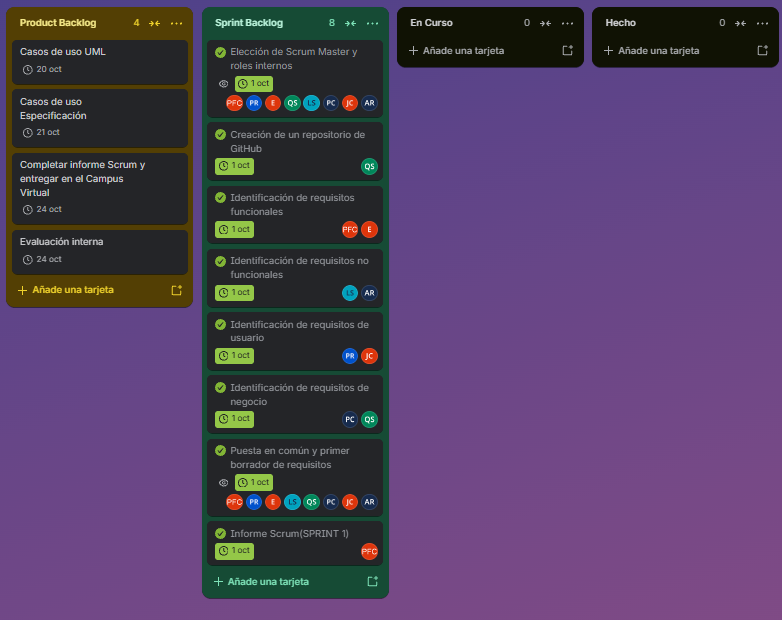
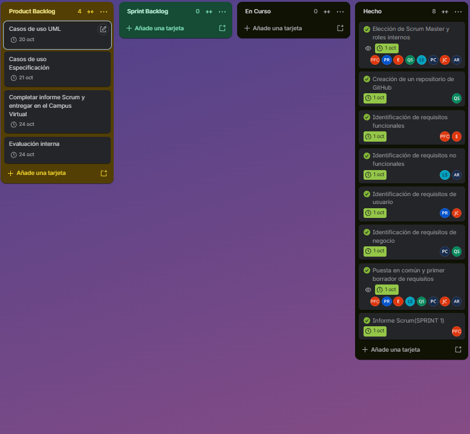
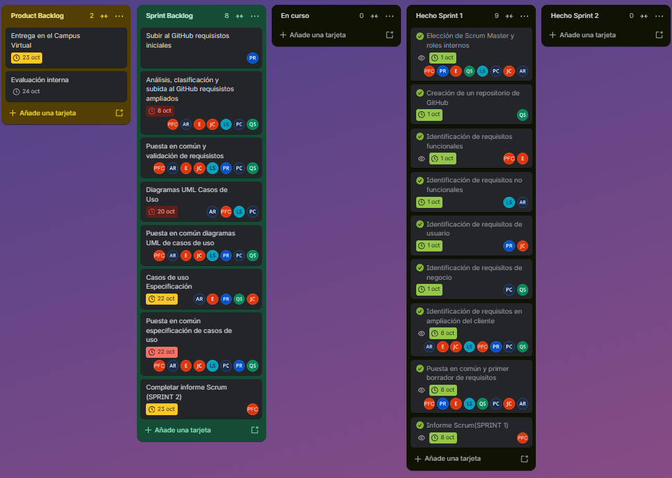
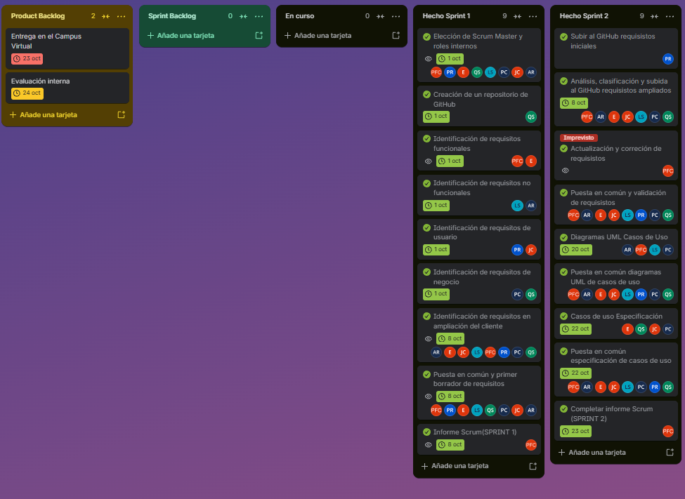

# Informe Scrum: Entrega 1 
 
## 1. Identificación del equipo 
| Nombre y apellidos              | Rol |
|---|---|
| Pablo Fernández Carabantes      | Scrum Master | 
| Carlos “Emérito” López Lovera   | Dev | 
| Juan Romero Cobos               | Dev | 
| Laura Santiago Medina           | Dev | 
| Andrés Felipe Jaramillo Ranzini | Dev | 
| Su Qihao                        | Dev |
| Pablo Roldán Coll               | Dev |
| Pablo Ferreiro Romero           | Dev |
 
## 2. Organización del trabajo 

 Durante la primera entrega, hemos adoptado la metodología Scrum. El trabajo se ha organizado de la siguiente manera:

 - Control de versiones: En la primera sesión se creó un repositorio GitHub con el objetivo de subir las tareas realizadas para la visibilidad de todo el grupo

 - Gestión de tareas: Para la organización y tableros se ha utilizado Trello.

 - Para la extracción de los requisitos presentados por TurbineH en la presentación del método del caso el 29/09/26, el equipo se dividió en subgrupos encargados de clasificar todos los requisitos encontrados (Requisitos Funcionales, Requisitos No Funcionales, Requisitos de Usuario y Requisitos de Negocio) para su posterior debate y puesta en común de los requisitos finales.

 - Cada tarea es asignada por el Scrum Master en consenso con todo el equipo. Antes de comenzar cada bloque de trabajo organizamos una reunión breve para decidir como abordarlo y al finalizar cada tarea, realizamos una puesta en común y debate grupal. 
 Ninguna tarea realizada es definitiva sin antes haber sido expuesta, debatida y validada previamente por todos los miembros del grupo, garantizando así una coherencia en el trabajo realizado y una responsabilidad compartida. 

## 3. Sprints realizados 
 
### Sprint 1 
 
- Fecha de inicio: 01/10/26 8:45am
- Fecha de finalización: 01/10/26 18:00pm
- Objetivo del Sprint: 
    Comprender y debatir el problema planteado por TurbineH, establecer los roles dentro del equipo, creación de un repositorio compartido en GitHub y la realización de una primera clasificación y extracción de requisitos para el sistema de facturación solicitado.

- Tareas planificadas: 
    - Elección del Scrum Master y definición de roles internos para cada tarea.
    - Creación del repositorio GitHub
    - Identificación de requisitos funcionales, no funcionales, de negocio y de usuario.
    - Realización del Informe Scrum Sprint 1 

- Tareas completadas: 
    - Elección del Scrum Master y definición de roles
    - Creación del repositorio GitHub
    - Creación del primer borrador común de la primera versión de los requisitos extraídos.
    - Realización del informe Scrum y creación del tablero en Trello

- Reuniones realizadas: 

| Fecha | Hora aprox | Duración | Participantes | Temas abordados | 
|---|---|---|---|---|
| 01/10/2026 | 09:10 | 20 minutos | Todo el equipo | Toma de contacto sobre la charla del método del caso y exposición de las notas individuales de cada miembro. |
| 01/10/2026 | 09:30 | 40 minutos | Todo el equipo | Reunión de planificación previa: reparto en subgrupos del trabajo de requisitos. |
| 01/10/2026 | 10:10 | 20 minutos | Todo el equipo | Reunión posterior de debate: exposición del trabajo de cada subgrupo y validación. | 
| 01/10/2026 | 18:00 | 20 minutos | Todo el equipo | Revisión del informe Scrum Sprint 1 elaborado por el Scrum Master, y establecer como completados las tareas del tablero del Sprint Retroespective en Trello | 

- Problemas encontrados: Durante la clasificación de requisitos y actores del sistema, surgieron distintos puntos de vista y dudas importantes respecto a los roles. El equipo no tenía claro si era realmente necesario separar la figura del Superadministrador de la del Administrador, debido a la falta de claridad en la información inicial.
- Soluciones aplicadas: Se debatió el problema en la puesta en común final y tras consultarlo con el profesor se decidió dejarlo pendiente de revisión para el siguiente sprint, a la espera de la transcripción de la charla y de una ampliación de requisitos para tomar una decisión definitiva.
 
#### Estado del tablero en el Sprint Planning 
En Trello no aparecen los nombres completos sino unas siglas:
PFC = Pablo Fernández Carabantes
E = Carlos “Emérito” López Lovera
JC = Juan Romero Cobos
LS = Laura Santiago Medina
AR = Andrés Felipe Jaramillo Ranzini
SQ = Su Qihao
PC = Pablo Roldán Coll
PR = Pablo Ferreiro Romero

 
 

#### Estado del tablero en la Sprint Retrospective 
 
 
 
### Sprint 2 
 
- Fecha de inicio: 08/10/26
- Fecha de finalización: 23/10/26
- Objetivo del Sprint:
   Consolidar una versión definitiva y sin conflictos de los requisitos, integrando la ampliación de requisitos, para utilizarlos como base del diseño funcional. A partir de ahí, modelar la arquitectura mediante diagramas UML, redactar las fichas de especificación de los casos de uso y garantizar la coherencia del sistema elaborando la trazabilidad.
- Tareas planificadas:
    - Subida al GitHub del primer borrador de los requisitos extraidos en el sprint 1.
    - Análisis, identificación de los requisitos ampliados.
    - Puesta en común de los requisitos extraidos.
    - Creación de la trazabilidad entre requisitos.
    - Definición de reglas de negocio.
    - Redacción de los casos de uso.
    - Creación y modelado de los diagramas UML de Casos de Uso divididos por bloques funcionales.
    - Puesta en común de los diagramas UML de Casos de Uso.
    - Especificación de los casos de uso.
    - Subir los borradores de diagramas UML de casos de uso al GitHub.
    - Subir los  borradores de especificación al GitHub.
    - Subir el informe Scrum completo al GitHub.
- Tareas completadas:
    - Subida al GitHub del primer borrador de los requisitos extraidos en el sprint 1.
    - Análisis, identificación de los requisitos ampliados.
    - Imprevisto. Revisión profunda del borrador de requisitos, limpieza de contradicciones y agrupación de requisitos comunes.
    - Puesta en común de los requisitos extraidos.
    - Documento .md de requisitos actualizado y validado mediante Pull Request.
    - Trazabilidad entre requisitos completada.
    - Definición de reglas de negocio.
    - Redacción de los casos de uso.
    - Diagramas UML de Casos de Uso y capturas de plantUML
    - Especificación de los casos de uso.
- Reuniones realizadas:

| Fecha | Hora aprox | Duración | Participantes | Temas abordados |
|---|---|---|---|---|
| 08/10/2026 | 09:00 | 10 minutos | Todo el equipo menos Carlos “Emérito” López Lovera por examen en la misma hora | Planificación inicial del sprint 2 en la que se indicó la metodología a seguir en esa semana para subir los requisitos iniciales, y analizar e identificar los requisitos ampliados|
| 17/10/2026 | 12:00 | 20 minutos | Todo el equipo | Reunión para presentar varios imprevistos con los requisitos ampliados e iniciales en la que se acordó actualizarlos y arreglarlos para que no hubiese problemas de contradicciones y duplicados a la hora de hacer los casos de uso y los diagramas UML de casos de uso. |
| 18/10/2026 | 17:00 | 35 minutos | Todo el equipo | Presentación a todos los miembros de los nuevos requisitos actualizados y su posterior puesta en común. |
| 19/10/2026 | 16:30 | 15 minutos | Todo el equipo | Planificación y reparto en subgrupos para la realización de los diagramas UML de Casos de Uso y la especificación |
| 22/10/2026 | 8:45 | 1h y 45 minutos | Todo el equipo menos Pablo Ferreiro por examen en la misma hora | Puesta en común de los diagramas UML de Casos de Uso y realización de la especificación.|
| 23/10/2026 | XX:XX | 1h y 45 minutos | Todo el equipo | Puesta en común de la especificación|

- Problemas encontrados:

   - Tras la realización de los requisitos ampliados se detectó que una parte de la extracción y la identificación era incorrecta,
  pues varios requisitos entraban en conflicto. Lo que provocó un imprevisto en la planificación original y se tuvo que hacer una
  actualización y corrección de requisitos para después presentarlos y validarlos por los miembros del equipo.
    - Tras la puesta en común de los diagramas UML y posterior validación del profesor en la clase práctica, se detectó que el caso de uso CU-02(Detectar cliente duplicado) no debía modelasrse como un caso de uso independiente. 
 
  
- Soluciones aplicadas:
    - Se procedió a la lectura de requisitos ampliados por segunda vez y al analisis de dichas páginas. Una vez obtenido todos los requisitos otra vez se presentaron al grupo para su validación, para poder seguir con la planificación inicial.
   - Respecto a la corrección del CU-02, el equipo evaluó el impacto de rehacer la arquitectura documental (lo que habría roto dependencias previas). Se optó por una solución ágil consultada con el profesor de prácticas, mantener la trazabilidad añadiendo una nota técnica aclaratoria en los diagramas y en la sección de decisiones de requisitos.md. Estas notas especifican formalmente que el CU-02 se interpreta y absorbe como un flujo de excepción, garantizando la coherencia metodológica sin comprometer la estabilidad del sistema a escasos días de la entrega.
#### Estado del tablero en el Sprint Planning 
 
 
 
#### Estado del tablero en la Sprint Retrospective 
 
 
 
## 4. Problemas y riesgos 

## 5. Valoración final 
 
Reflexión sobre el trabajo realizado y propuestas de mejora. 
