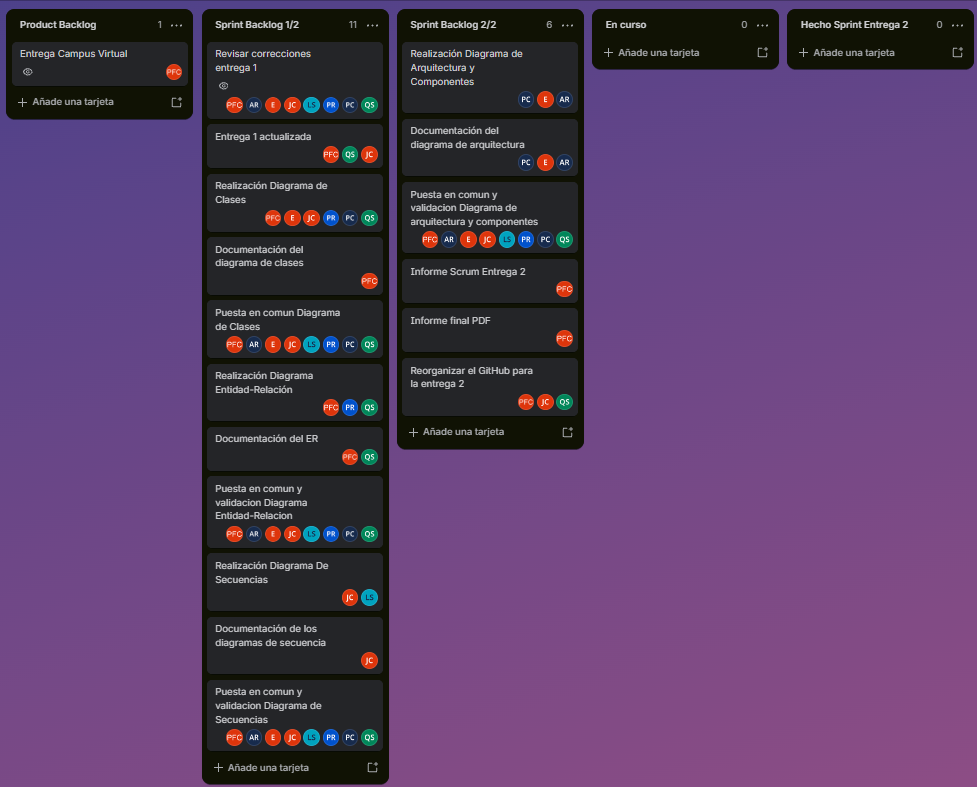
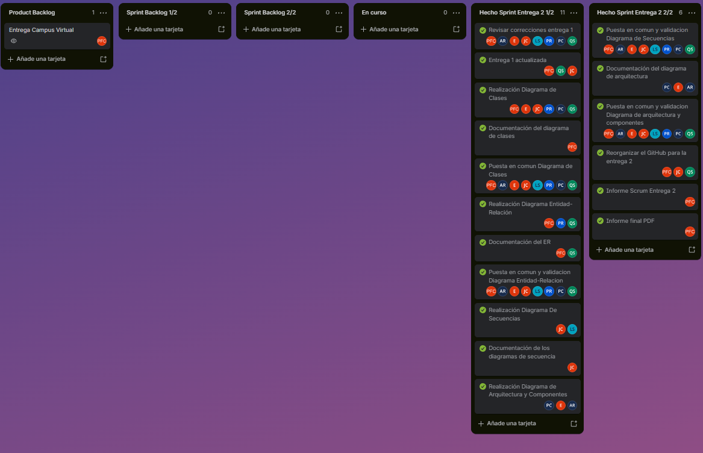

# Informe Scrum · Entrega 2

## Identificación del equipo

| Nombre y apellidos | Rol en esta entrega |
|---|---|
| Pablo Fernández Carabantes      | Scrum Master | 
| Carlos “Emérito” López Lovera   | Dev | 
| Juan Romero Cobos               | Dev | 
| Laura Santiago Medina           | Dev | 
| Andrés Felipe Jaramillo Ranzini | Dev | 
| Su Qihao                        | Dev |
| Pablo Roldán Coll               | Dev |
| Pablo Ferreiro Romero           | Dev |

## Reuniones del periodo

| Fecha | Inicio | Duración | Participantes | Temas y acuerdos |
|---|---|---|---|---|
| 29/10/2026 | 08:45 | 45 min | Todos los integrantes menos Juan Romero Cobos| Planificación; Revisión informes Entrega 1 entregados por el profesor |
| 05/11/2026 | 08:45 | 30 min | Todos los integrantes | Planificación para la elaboración del diagrama de clases |
| 12/11/2026 | 08:45 | 30 min | Todos los integrantes menos Carlos “Emérito” López Lovera y Laura Santiago Medina | Presentación de los diagramas de clases elaborados y planificación de una puesta en común conjunta. |
| 23/11/2026 | 17:00 | 15 min | Todos los integrantes | Puesta en común del diagrama de clases y reparto de los diagramas restantes |
  | 26/11/2026 | 08:45 | 1h:45 min | Todos los integrantes menos Carlos “Emérito” López Lovera por enfermedad | Puestas en común diagramas ER, Secuencia y Arquitectura, y preparación del github para la entrga |

## Estado del product backlog y Sprint backlog
En Trello aparecen siglas en lugar de nombres: PFC = Pablo Fernández Carabantes, E = Carlos “Emérito” López Lovera, JC = Juan Romero Cobos, LS = Laura Santiago Medina, AR = Andrés Felipe Jaramillo Ranzini, SQ = Su Qihao, PC = Pablo Roldán Coll, PR = Pablo Ferreiro Romero.

**Tablero:** https://trello.com/b/hA6VZlaG/tablero-entrega-2

Añadir **capturas reales legibles** del estado del tablero en Sprint Planning y Sprint Retrospective. Copiar las imágenes a `entrega2/evidencias/` y enlazarlas así (descomentar con archivos existentes):

<!--  -->
<!--  -->

## Información de tareas

| Tarea | Responsable | Milestone | Prioridad | Etiqueta | Descripción / estado |
|---|---|---|---|---|---|
| Revisar las correcciones de la Entrega 1 | Todo el equipo | Entrega 2 | Alta | documentación | COMPLETADO |
| Aplicar las correcciones de la Entrega 1 | Pablo Fernández Carabantes, Juan Romero Cobos, Su Qihao | Entrega 2 | Alta | documentación | COMPLETADO |
| Diagrama de Clases | Pablo Fernández Carabantes, Carlos “Emérito” López Lovera, Juan Romero Cobos, Su Qihao, Pablo Roldán Coll, Pablo Ferreiro Romero | Entrega 2 | Alta | diagrama | Realización de diagramas de clases. COMPLETADO|
| Puesta en común diagrama de clases | Todos los integrantes | Entrega 2 | Alta | diagrama | Puesta en común utilizando todos los diagramas realizados por los miembros del equipo. COMPLETADO |
| Documentación del diagrama de clases | [COMPLETAR] | Entrega 2 | Media | documentación | diagrama_clases.md con decisiones de diseño, trazabilidad y consistencia con el ER. COMPLETADO. |
| Modelo entidad-relación | Pablo Fernández Carabantes, Su Qihao, Pablo Ferreiro Romero | Entrega 2 | Alta | diagrama | Realización del diagrama ER. COMPLETADO. |
| Documentación del ER | Pablo Fernández Carabantes, Su Qihao, Pablo Ferreiro Romero | Entrega 2 | Alta | documentación | modelo_datos.md con reglas, trazabilidad y decisiones abiertas. COMPLETADO. |
| Presentación y validación del diagrama ER | Todos los integrantes del grupo | Entrega 2 | Alta | documentación | Presentación del diagrama ER a los demás miembros del grupo para su validación. COMPLETADO. |
| Realización diagramas de secuencia | Juan Romero Cobos, Laura Santiago Medina | Entrega 2 | Alta | diagrama | Diagramas de Secuencias. EN CURSO |
| Presentación y validación de los diagramas de secuencia | Todos los integrantes | Entrega 2 | Media | revisión | Presentación de los diagramas de secuencia a los demás miembros del grupo para su validación. EN CURSO.|
| Diagrama de arquitectura | Pablo Roldán Coll, Carlos “Emérito” López Lovera, Andrés Felipe Jaramillo Ranzini,   | Entrega 2 | Alta | diagrama | Realización del diagrama de arquitectura. COMPLETADO |
| Documentación del Diagrama de arquitectura | Pablo Roldán Coll, Carlos “Emérito” López Lovera, Andrés Felipe Jaramillo Ranzini,   | Entrega 2 | Alta | diagrama | Documentación del diagrama de arquitectura. COMPLETADO |
| Presentación y validación del diagrama de arquitectura | Todos los integrantes | Entrega 2 | Media | revisión | Presentación de los diagramas de arquitectura a los demás miembros del grupo para su validación. COMPLETADO.|
| Informe Scrum | Pablo Fernández Carabantes | Entrega 2 | Media | gestión | Este documento y las capturas del tablero. En curso. |
| Informe final | Pablo Fernández Carabantes | Entrega 2 | Alta | documentación | Realización del informe final gracias a los informes de todos los diagramas. Pendiente. |
| Organización Repositorio Plantilla entrega 2 | Pablo Fernández Carabantes, Juan Romero Cobos, Su Qihao | Entrega 2 | Alta | documentación | Organizar el repositorio según la plantilla y generar el PDF de la entrega. COMPLETADO. |

## Problemas y riesgos

| Sprint | Problema/riesgo | Impacto | Medida aplicada | Estado |
|---|---|---|---|---|
| Entrega 2 | Duda sobre por qué diagrama empezar. | Sin un orden claro no se podía repartir el trabajo, porque el ER y los diagramas de secuencia dependen de las clases y sus operaciones. | Tras comentar el profesor en clase el orden recomendado, se hizo primero el diagrama de clases entre todos y se validó en grupo antes de repartir el resto de diagramas en subgrupos. | Resuelto |
| Entrega 2 | Corrección pendiente de la Entrega 1: numeración del bloque B. | Los identificadores de casos de uso no coincidían entre documentos. | Renumeración a CU-05…CU-09 y comprobación del resto de documentos. | Resuelto |

## Revisión y retrospectiva

- **Logros:** se han terminado los diagramas de clases, ER, secuencia y arquitectura con su documentación, y se han validado y presentado con todo el grupo por lo tanto todos los miembros tienen conocimiento de los diagramas. Además se ha corregido la numeración del bloque B de la Entrega 1.
- **Aspectos positivos:** hacer primero el diagrama de clases entre todos y validarlo antes de repartir el resto ayudó a que los demas diagramas partieran de la misma base. El trabajo en subgrupos permitió avanzar varios diagramas a la vez.
- **Mejoras:** acordar para la siguiente entrega desde el inicio el orden en que se hacen las tareas, para poder repartir el trabajo antes, de todas formas en esta entrega se han realizado todos los diagramas e informes validandolos entre todos los miembros del grupo.
- **Acciones siguientes:** contrastar hipótesis con el cliente y preparar Entrega 3.
